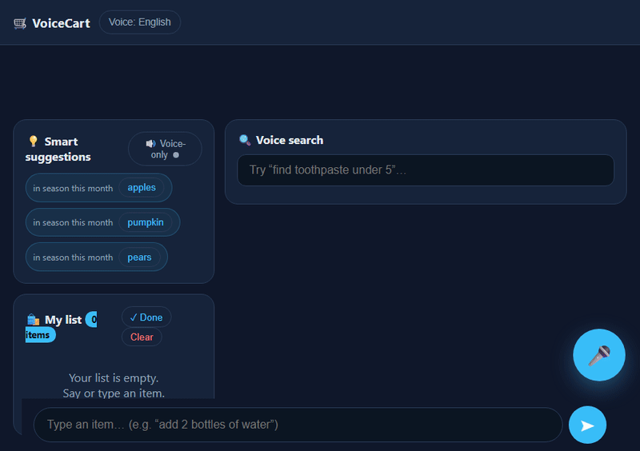

# 🛒 VoiceCart

<div align="center">

[](https://opensource.org/licenses/MIT)
[](https://github.com/parthmishra9942/voicecart)
[](https://github.com/parthmishra9942/voicecart)
[](https://github.com/parthmishra9942/voicecart)
[](https://github.com/parthmishra9942/voicecart)

<h3>Privacy-First, On-Device Voice Shopping Assistant & Intelligent Recommendation Engine</h3>

<p align="center">
  <b>No raw audio uploaded to the cloud. Real explainable rule-based NLU. 3 data-driven recommendation engines. Complete offline PWA.</b>
</p>

</div>

---

## 🎬 Product Showcase

<div align="center">
  
  <p><i>Live voice waveform HUD → Continuous speech transcription → Instant multi-entity cart resolution.</i></p>
</div>

> 📹 **Watch Full HD Launch Video:** Inspect [`media/launch_video.mp4`](media/launch_video.mp4) or view the showcase poster [`media/poster.jpg`](media/poster.jpg).

---

## ⚡ Why VoiceCart Beats Generic AI Wrappers

Most "AI shopping list" apps are thin wrappers: they stream your ambient microphone audio to remote servers, require constant cellular connectivity, and hallucinate suggestions without real math.

VoiceCart runs entirely in the browser using the **Web Speech API**, a **custom deterministic NLU tokenizer**, and **three recommendation engines** with zero backend overhead.

| Trait | Typical "AI" Voice App | **VoiceCart** |
| :--- | :---: | :---: |
| **Audio Privacy** | ❌ Raw voice audio streamed to cloud | 🔒 **100% On-Device (Never leaves browser)** |
| **Connectivity** | ❌ Fails completely in poor signal / offline | ⚡ **Full Offline PWA (Cached Service Worker)** |
| **NLU Transparency** | ⚠️ Black-box LLM prompt injection risks | 🛡️ **Rule-based & unit-tested NLU parser** |
| **Recommendations** | ❌ Random LLM hallucinations | 📊 **Purchase Decay + 12-Month Seasonal + Sub Graph** |
| **Hosting Cost** | 💸 High cloud GPU & API token bills | 🆓 **Zero Backend (Free static hosting on GitHub Pages)** |

---

## 🏗️ 3D Audio & Intent Pipeline Architecture

```
                  ┌────────────────────────────────────────┐
                  │       Browser Web Speech Audio         │
                  │   Continuous Stream / Voice-First HUD  │
                  └───────────────────┬────────────────────┘
                                      │
                                      ▼
    ┌────────────────────────────────────────────────────────────────────┐
    │                       Client NLU Engine Layer                      │
    │                                                                    │
    │  ┌───────────────────────┐            ┌─────────────────────────┐  │
    │  │ Intent Classification │            │ Entity Tokenizer        │  │
    │  │ (Add/Remove/Find/Qty) │            │ (Units, Multi-lang, HI) │  │
    │  └───────────┬───────────┘            └───────────┬─────────────┘  │
    └──────────────┼────────────────────────────────────┼────────────────┘
                   │                                    │
                   ▼                                    ▼
    ┌────────────────────────────────────────────────────────────────────┐
    │                    Tri-Engine Recommendation Mesh                   │
    │                                                                    │
    │  ┌────────────────────┐ ┌────────────────────┐ ┌────────────────┐  │
    │  │ 🔁 Reorder Engine  │ │ 🍂 Seasonal Engine │ │ 🌱 Sub Graph   │  │
    │  │ Purchase Frequency │ │ Current Month Peak │ │ Dietary & Diet │  │
    │  │ Recency Decay Math │ │ Harvest Produce    │ │ Alternatives   │  │
    │  └────────────────────┘ └────────────────────┘ └────────────────┘  │
    └─────────────────────────────────┬──────────────────────────────────┘
                                      │
                                      ▼
                  ┌────────────────────────────────────────┐
                  │     Reactive State & UI Projection     │
                  │   IndexedDB / LocalStorage Persistence │
                  └────────────────────────────────────────┘
```

---

## 🧠 The 3 Recommendation Engines Explained

1. **🔁 Reorder Engine (Recency & Frequency Decay):**  
   Tracks purchase timestamps and applies exponential recency decay scoring ($S = \sum e^{-\lambda \Delta t}$) to automatically bubble up essentials you regularly need.
2. **🍂 Seasonal Engine (12-Month Harvest Matrix):**  
   Pre-calibrated produce matrix cross-referencing the current system month to highlight peak freshness, best pricing, and local harvest windows.
3. **🌱 Substitution Graph (Allergen & Preference Engine):**  
   Directed ontology mapping dairy, gluten, and common staples to ethical/dietary alternatives (e.g., cow's milk $\to$ oat/almond/soy milk; peanut butter $\to$ sunflower butter).

---

## 🚀 Quickstart

Run directly on any computer with zero build toolchain required:

```bash
# 1. Clone the repository
git clone https://github.com/parthmishra9942/voicecart.git
cd voicecart

# 2. Start local static server (Python or Node)
python -m http.server 5000
# or: npx serve .
```

Open `http://localhost:5000` in Google Chrome or Microsoft Edge (which support native continuous SpeechRecognition).

### Running Automated Test Suite

```bash
npm test        # Runs 34 headless NLU unit tests + 11 frontend checks
npm run lint    # ESLint validation across js/ and tests/
```

---

## 👨‍💻 Author

**Parth Mishra**  
- GitHub: [@parthmishra9942](https://github.com/parthmishra9942)  
- Portfolio: [ai-portfolio-beige-xi.vercel.app](https://ai-portfolio-beige-xi.vercel.app/)  
- LinkedIn: [linkedin.com/in/parth-mishra-4b7578242](https://linkedin.com/in/parth-mishra-4b7578242)

---

## 📄 License

Distributed under the **MIT License**.